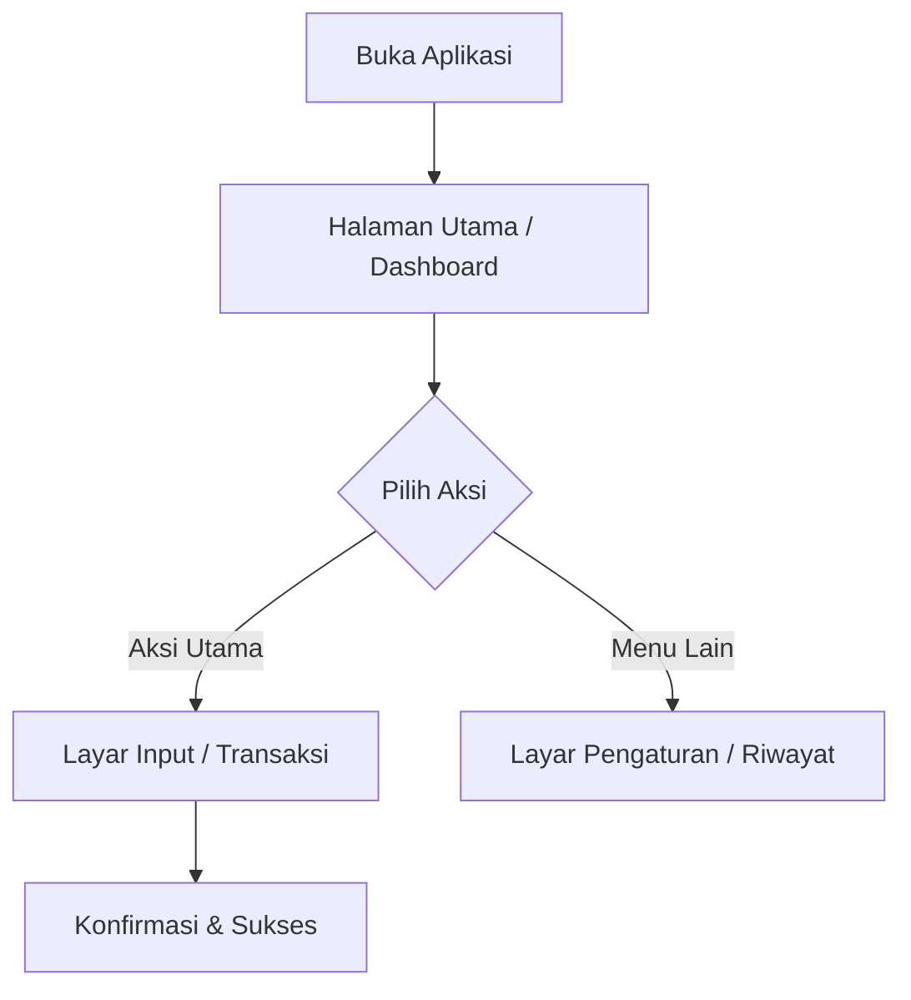

<!--
=====================================================================
INSTRUKSI UNTUK AI — BACA BAGIAN INI TERLEBIH DAHULU
=====================================================================
Anda adalah asisten penyusun Design Document (Desain Antarmuka, UI/UX & Sistem Desain).
Format dokumen WAJIB mengikuti struktur di bawah ini secara persis.
Hapus seluruh komentar instruksi HTML <!-- ... --> pada hasil akhir dokumen.
=====================================================================
-->

# Design Document: {{NAMA_PRODUK}}

**STATUS: DRAFT SEMENTARA**

| | |
| :--- | :--- |
| **Produk / Aplikasi** | {{NAMA_PRODUK}} |
| **Versi Dokumen** | v0.1 |
| **Disusun oleh** | {{DISUSUN_OLEH}} |
| **Untuk** | {{UNTUK}} |
| **Tanggal** | {{TANGGAL_DOKUMEN}} |
| **Dokumen Terkait** | PRD / Notulen Ide |

---

## Referensi Visual

<!-- Jika ada gambar referensi yang diunggah pengguna:
Sertakan setiap gambar:
### Referensi 1 — <Nama Gambar / Layar>

- **Design Language**: (contoh: glassmorphism, bento grid, clean modern, dark minimalis)
- **Palet Terdeteksi**: kode hex dan porsi warna
- **Tipografi**: gaya font
- **Spacing & Radius**: grid dan radius sudut
- **Diadopsi ke Dokumen Ini**: nilai token spesifik yang diterapkan

Jika BELUM ada gambar referensi:
*(Menunggu referensi gambar — lampirkan 1-3 screenshot inspirasi UI lewat ikon penjepit agar token visual diselaraskan).*
-->

## 1. Prinsip Desain (Design Principles)

1. **Clarity (Kejelasan)** — Antarmuka bersih, visual hierarchy yang jelas, dan fokus pada konten serta aksi utama tanpa distraksi.
2. **Consistency (Konsistensi)** — Pola interaksi, tombol, warna, dan tipografi seragam di seluruh layar.
3. **Efficiency (Efisiensi)** — Meminimalkan langkah pengguna (low click count), alur transaksi cepat, dan navigasi intuitif.
4. **Delight & Accessibility** — Micro-interaction yang responsif dan mematuhi standar aksesibilitas WCAG AA.

## 2. Persona & Kebutuhan Pengguna

| Persona | Peran Pengguna | Tujuan Utama | Kendala (Pain Points) | Solusi Desain |
| :--- | :--- | :--- | :--- | :--- |
| {{PERSONA_1}} | {{PERAN_1}} | {{GOAL_1}} | {{PAIN_1}} | {{SOLUSI_1}} |
| {{PERSONA_2}} | {{PERAN_2}} | {{GOAL_2}} | {{PAIN_2}} | {{SOLUSI_2}} |

## 3. Alur Pengguna (User Flow)

### 3.1 Alur Interaksi Layar
1. {{LANGKAH_1}}
2. {{LANGKAH_2}}
3. {{LANGKAH_3}}

<!-- WAJIB: Ganti diagram flowchart TD di atas dengan alur interaksi layar nyata untuk aplikasi ini. Minimal 5-7 node. Setiap label node dan alur panah WAJIB diapit tanda kutip ganda. -->

## 4. Inventaris Layar & Arsitektur Informasi (Screen Inventory)

| No | Nama Layar / Halaman | Hirarki / Rute | Komponen Utama | Tujuan & Fungsi |
| :--- | :--- | :--- | :--- | :--- |
| 1 | {{LAYAR_1}} | `/` (Utama) | {{KOMPONEN_1}} | {{FUNGSI_1}} |
| 2 | {{LAYAR_2}} | `/dashboard` | {{KOMPONEN_2}} | {{FUNGSI_2}} |
| 3 | {{LAYAR_3}} | `/transaksi` | {{KOMPONEN_3}} | {{FUNGSI_3}} |
| 4 | {{LAYAR_4}} | `/riwayat` | {{KOMPONEN_4}} | {{FUNGSI_4}} |

## 5. Komponen UI (UI Components)

### 5.1 Navigasi & Tata Letak
- **Header / Top Navbar**: Memuat logo merek, breadcrumbs/judul halaman, bilah pencarian, dan avatar profil pengguna.
- **Sidebar Navigation**: Navigasi vertikal menu aplikasi (Dashboard, Menu, Transaksi, Laporan, Pengaturan), dengan mode collapsible responsif di layar mobile.
- **Container / Cards**: Elemen pembungkus kartu berlatar surface dengan border tipis dan sudut membulat untuk memisahkan grup informasi.

### 5.2 Komponen Interaktif & Formulir
- **Buttons (Tombol)**:
  - *Primary Button*: Aksi utama (misal Simpan, Tambah, Bayar) dengan saturasi warna kontras tertinggi.
  - *Secondary / Outline Button*: Aksi sekunder (misal Batal, Filter, Ekspor).
  - *Destructive Button*: Aksi kritis (misal Hapus data, Batalkan pesanan).
  - Status interaksi: Default, Hover, Active, Disabled, Loading (spinner state).
- **Form Controls**: Input teks, dropdown select, switch toggle, checkbox dengan label eksplisit dan pesan validasi visual (error / helper text).
- **Modals & Drawers**: Modal dialog pop-up di tengah layar untuk konfirmasi penting, serta drawer geser samping untuk formulir cepat.
- **Feedback & Notifikasi**: Toast notification (Sukses, Peringatan, Gagal), badge status indikator, serta empty state dengan ilustrasi dan tombol aksi (CTA).

## 6. Design Tokens & Sistem Gaya (Design Tokens)

### 6.1 Palet Warna
| Kategori Token | Nama Token | Nilai Hex | Penggunaan / Elemen |
| :--- | :--- | :--- | :--- |
| Background | `bg-main` | `#090D16` / `#F8FAFC` | Latar belakang halaman utama |
| Surface / Card | `bg-surface` | `#111827` / `#FFFFFF` | Latar kartu, container, panel |
| Border | `border-subtle` | `#1F2937` / `#E2E8F0` | Garis pembatas komponen |
| Primary / Accent | `color-primary` | `{{HEX_PRIMARY}}` | Tombol utama, tab aktif, link |
| Secondary Accent | `color-secondary` | `{{HEX_SECONDARY}}` | Elemen aksen pendukung |
| Text Primary | `text-primary` | `#F9FAFB` / `#0F172A` | Judul, label penting, teks utama |
| Text Muted | `text-muted` | `#9CA3AF` / `#64748B` | Subtitle, placeholder, catatan kaki |
| Status Success | `status-success` | `#10B981` | Notifikasi berhasil, indikator aktif |
| Status Danger | `status-danger` | `#EF4444` | Pesan error, tombol hapus |

### 6.2 Tipografi
| Hirarki | Ukuran Font | Bobot (Weight) | Line Height | Penggunaan Elemen |
| :--- | :--- | :--- | :--- | :--- |
| Display / H1 | 30px – 36px | Bold (700) | 1.2 | Judul layar utama |
| H2 | 22px – 24px | Semibold (600) | 1.3 | Subjudul / Nama kartu utama |
| H3 | 18px – 20px | Medium (500) | 1.4 | Judul bagian / Section heading |
| Body Regular | 14px – 16px | Normal (400) | 1.5 | Paragraf teks, isi form |
| Caption / Small | 12px – 13px | Normal (400) | 1.4 | Helper text, badge, keterangan |

### 6.3 Spacing, Grid & Corner Radius
- **Grid Sistem**: Berbasis skala 4px / 8px (4px, 8px, 12px, 16px, 24px, 32px, 48px).
- **Corner Radius**:
  - `radius-sm` (4px): Checkbox, tag kecil.
  - `radius-md` (8px): Input text, tombol reguler, badge.
  - `radius-lg` (12px – 16px): Card container, modal pop-up.
  - `radius-full` (9999px): Avatar, pill button, badge bulat.
- **Elevation / Shadow**: Border halus dipadukan drop shadow soft (0 4px 6px -1px rgba(0,0,0,0.1)).

## 7. Interaksi & Motion (Micro-interactions)
- **Durasi Transisi**: 150ms – 250ms untuk transisi hover dan perubahan state tombol.
- **Feedback Transaksi**: Indikator loading spinner saat submit formulir, shimmer/skeleton loader saat memuat data list.
- **Transisi Modal**: Fade-in halus dan subtle zoom (durasi 200ms) dengan backdrop blur.

## 8. Aksesibilitas (Accessibility / A11y)
- **Rasio Kontras**: Minimal 4.5:1 untuk teks normal terhadap warna background (WCAG AA).
- **Navigasi Keyboard**: Seluruh tombol, input, dan menu dapat dinavigasi dengan tombol `Tab` dengan outline ring fokus yang jelas.
- **Touch Target**: Ukuran tombol minimal 44x44px pada mode sentuh mobile.
- **Screen Reader**: Semua ikon dan elemen gambar wajib memiliki `aria-label` atau atribut `alt` deskriptif.
