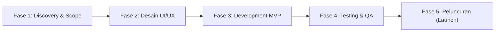

<!--
=====================================================================
INSTRUKSI UNTUK AI — BACA BAGIAN INI TERLEBIH DAHULU
=====================================================================
Anda adalah asisten penyusun Project Plan (Rencana Proyek, Linimasa & WBS).
Format dokumen WAJIB mengikuti struktur di bawah ini secara persis.
Hapus seluruh komentar instruksi HTML <!-- ... --> pada hasil akhir dokumen.
=====================================================================
-->

# Project Plan: {{NAMA_PROYEK}}

**STATUS: DRAFT SEMENTARA**

| | |
| :--- | :--- |
| **Nama Proyek** | {{NAMA_PROYEK}} |
| **Versi Dokumen** | v0.1 |
| **Disusun oleh** | {{DISUSUN_OLEH}} |
| **Untuk** | {{UNTUK}} |
| **Tanggal** | {{TANGGAL_DOKUMEN}} |
| **Target Selesai** | {{TARGET_SELESAI}} |

---

## 1. Ringkasan Proyek (Overview)

<!-- 2 paragraf: latar belakang proyek, deskripsi solusi yang akan dibangun, dan nilai bisnis utama yang ingin dicapai. -->
{{RINGKASAN_PROYEK}}

## 2. Tujuan & Sasaran (Goals & Objectives)

- **Sasaran Utama**: Meluncurkan MVP yang fungsional, stabil, dan tepat waktu untuk memvalidasi kebutuhan pengguna.
- **Target Terukur**:
  - {{TARGET_1}}
  - {{TARGET_2}}
  - {{TARGET_3}}

## 3. Ruang Lingkup (Scope of Work)

| Di Dalam Lingkup (In-Scope / MVP) | Di Luar Lingkup (Out-of-Scope / Fase Lanjutan) |
| :--- | :--- |
| {{IN_SCOPE_1}} | {{OUT_SCOPE_1}} |
| {{IN_SCOPE_2}} | {{OUT_SCOPE_2}} |
| {{IN_SCOPE_3}} | {{OUT_SCOPE_3}} |
| {{IN_SCOPE_4}} | {{OUT_SCOPE_4}} |

## 4. Linimasa & Tonggak Pencapaian (Milestones & Timeline)

### 4.1 Tabel Linimasa Milestone
| # | Fase / Milestone | Estimasi Durasi | Target Waktu | Output Utama (Deliverable) |
| :--- | :--- | :--- | :--- | :--- |
| 1 | Fase 1: Discovery & Scope | 1 Minggu | {{WAKTU_FASE_1}} | Dokumen Spesifikasi, User Persona, Skema Awal |
| 2 | Fase 2: Desain UI/UX & Prototipe | 2 Minggu | {{WAKTU_FASE_2}} | Desain Mockup, Design System, Alur Layar |
| 3 | Fase 3: Pengembangan Inti (Development) | 3 - 4 Minggu | {{WAKTU_FASE_3}} | Fitur MVP, Skema Database, Integrasi Frontend/API |
| 4 | Fase 4: Pengujian & QA | 1 Minggu | {{WAKTU_FASE_4}} | Uji Fungsional, Perbaikan Bug, Staging Deployment |
| 5 | Fase 5: Peluncuran & Serah Terima | 1 Minggu | {{WAKTU_FASE_5}} | Production Deployment, Dokumentasi Panduan |

### 4.2 Diagram Alur Linimasa Proyek

<!-- WAJIB: Sertakan diagram flowchart LR linimasa di atas. Sesuaikan penamaan fase dengan kebutuhan proyek nyata. Setiap label node wajib diapit tanda kutip ganda. -->

## 5. Rincian Pekerjaan (Task Breakdown / WBS)

### Fase 1: Discovery & Perencanaan
- [ ] Pengumpulan kebutuhan pengguna dan finalisasi ruang lingkup (scope)
- [ ] Penentuan arsitektur sistem dan pemilihan stack teknologi
- [ ] Perancangan model entitas data / skema awal

### Fase 2: Perancangan UI/UX
- [ ] Pembuatan wireframe dan pemetaan alur pengguna (user flow)
- [ ] Penyusunan token desain (warna, tipografi, komponen)
- [ ] Desain mockup antarmuka pengguna (high-fidelity)

### Fase 3: Pengembangan Perangkat Lunak (Development)
- [ ] Inisialisasi struktur proyek, konfigurasi environment, dan repository
- [ ] Implementasi skema data dan modul autentikasi pengguna
- [ ] Pengembangan fitur-fitur inti (MVP)
- [ ] Integrasi frontend dengan penanganan data / backend

### Fase 4: Pengujian & Penjaminan Mutu (QA)
- [ ] Uji fungsional seluruh alur utama aplikasi
- [ ] Pengujian performa, keamanan dasar, dan responsivitas tampilan
- [ ] Perbaikan temuan bug dan penyesuaian masukan (bug fixing)

### Fase 5: Peluncuran & Deployment
- [ ] Konfigurasi hosting / server production dan environment live
- [ ] Migrasi data awal dan konfigurasi domain/SSL
- [ ] Peluncuran resmi ke publik dan pemantauan performa awal

## 6. Alokasi Tim & Peran (Team & Roles)

| Peran (Role) | Tanggung Jawab Utama | Alokasi / PIC |
| :--- | :--- | :--- |
| Project Manager / Lead | Koordinasi linimasa, mitigasi risiko, komunikasi stakeholder | {{PIC_PM}} |
| UI/UX Designer | Perancangan tampilan visual, prototipe, aset antarmuka | {{PIC_DESIGN}} |
| Software Developer | Pengembangan modul teknis, arsitektur data, integrasi logika | {{PIC_DEV}} |
| QA / Tester | Pengujian fitur, validasi alur sistem, pelaporan bug | {{PIC_QA}} |

## 7. Manajemen Risiko & Rencana Mitigasi (Risks & Mitigations)

| Identifikasi Risiko | Tingkat Probabilitas | Dampak | Rencana Mitigasi (Pencegahan & Solusi) |
| :--- | :--- | :--- | :--- |
| Perubahan ruang lingkup (Scope Creep) | Sedang | Tinggi | Kunci fitur MVP di awal; alihkan permintaan fitur tambahan ke rilis Fase 2. |
| Keterlambatan jadwal pengerjaan | Sedang | Sedang | Sediakan buffer waktu 20% pada tiap milestone dan evaluasi progres berkala. |
| Kendala teknis atau kompatibilitas | Rendah | Tinggi | Gunakan stack teknologi yang telah teruji dan buat prototipe teknis (spike) lebih awal. |

## 8. Kriteria Keberhasilan (Success Metrics / KPI)

- Seluruh fitur di Bab 3 (In-Scope) selesai diimplementasikan dan berfungsi dengan baik.
- Peluncuran aplikasi tercapai sesuai dengan estimasi tanggal target selesai.
- Stabilitas aplikasi terjaga dengan tingkat error blocker 0% saat serah terima.
- Kepuasan pengguna awal atau klien mencapai standar yang disepakati (> 80%).
